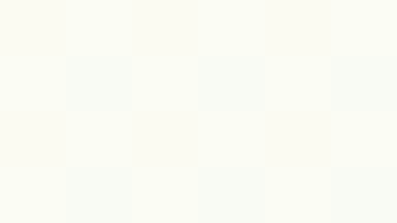

# Drawing Board · 描画

[简体中文](README.md) | [English](README.en.md)

A browser-based tool for creating whiteboard drawing animations on a single canvas. Combine images, text, and freehand strokes, then choose their layout, drawing order, and pauses to reveal a scene as you explain it.

Built for presentations, visual explanations, and individual scenes in short videos. Drawing Board uses plain HTML, CSS, JavaScript, and Canvas, with no frontend dependencies or application backend. Imported images and projects stay on your device. The editor currently has a Chinese interface; the steps below include its button labels.

## Demo

[](assets/demo.mp4)

[Watch the full MP4](assets/demo.mp4) · About 9 seconds · 1280 × 720 · Silent. Rendered from the built-in demo scene with HyperFrames.

## Features

- **Mixed layouts:** import PNG, JPG, and WebP images, add text, and move or resize elements.
- **Brush reveals:** uncover images and text from top left to bottom right, bottom left to top right, or along the four cardinal directions.
- **Stroke playback:** record freehand strokes and replay their paths, with pen lifts between separate strokes.
- **Sand reveals:** uncover content through a grainy texture.
- **Hand and pen:** show a transparent hand-holding-pen image that follows the drawing path, or turn it off.
- **Flexible timing:** change element order, drawing duration, start delay, and pause after drawing, or start elements together.
- **Preview and export:** play, pause, adjust playback speed, scrub through the scene, save an editable JSON project, or export a standalone HTML player.

## Run locally

You need Python 3 and a modern browser that supports Canvas and JavaScript modules.

```sh
git clone https://github.com/GenLix/drawing-board.git
cd drawing-board
python3 -m http.server 8765 --bind 127.0.0.1
```

Open **http://127.0.0.1:8765/**. The editor must be served over local HTTP; exported standalone HTML files can be opened directly and played offline.

## Create a scene

1. Click **New scene (新建画面)**, then add images, text, or draw a path with the pen tool.
2. Drag elements on the canvas. Use the right panel to set their dimensions, reveal effect, and direction.
3. Select an element in the left panel and use the up/down buttons to change its drawing order.
4. Set the drawing duration, delay before drawing, and pause after drawing, then click **Preview (播放预览)**.
5. Use **Save project (保存项目)** to keep an editable copy, or **Export HTML (导出 HTML)** to create a standalone player.

Pauses after drawing can last **0–600 seconds**. An element set to **After the previous element (接在上一项之后)** waits until that element finishes drawing and its pause ends. **Start with the previous element (与上一项同时开始)** uses the previous element's start time as its reference. The final element's pause also counts toward the scene duration. Hatched areas on the timeline indicate pauses.

## Export formats

| Format | Use |
| --- | --- |
| JSON | Save the layout, embedded images, strokes, and timing. Reopen it with **Open project (打开项目)** to continue editing. |
| HTML | Bundle the scene, images, hand asset, and playback code into one file for offline playback or external rendering. |
| MP4 | Use an external tool such as HyperFrames to render the exported HTML as a video. |

### Render a video with HyperFrames

Put the exported HTML in its own folder and rename it to `index.html`. With Node.js installed, run this command from that folder:

```sh
npx hyperframes@0.8.65 render . -o drawing-board.mp4
```

The exported HTML declares the canvas size and total duration, accepts time updates through `hf-seek`, and signals that assets are ready through `window.__hf.buildReady`. Pauses remain part of the timeline. [HyperFrames](https://github.com/heygen-com/hyperframes) handles rendering and video encoding; you do not need it to use the editor.

## Scope and limits

- Each project is a single **1280 × 720** scene with up to 40 elements. Imported images are limited to 8 MB each, and project JSON files to 32 MB.
- Ordinary text uses brush or sand reveals. It **does not automatically generate handwriting stroke order**. Stroke-by-stroke animation requires path data, as used by the demo title and recorded freehand strokes.
- The sand effect is a texture reveal, not a simulation of sand piling up or being pushed. It does not display the hand and pen.
- Text uses locally installed fonts, so its appearance may differ across operating systems.
- There is no multi-scene assembly, voiceover, audio timeline, or built-in MP4 encoder.

## Core files

| File | Responsibility |
| --- | --- |
| `index.html` / `style.css` | Editor interface and styles. |
| `app.mjs` | Editing, importing, previewing, and saving. |
| `core.mjs` | Project validation, timing, paths, and demo data. |
| `renderer.mjs` | Canvas rendering at a given time and image loading. |
| `export.mjs` | Standalone HTML packaging. |
| `assets/` | The hand image, its attribution and license, and the demo media. |

External tools can wait for `window.drawingBoard.ready`, then call `window.drawingBoard.renderAt(seconds)` to seek. Use `canvas` for the clean scene canvas, `getProject()` for project data, and `duration` for the total scene duration. Time is measured in seconds.

## License

Copyright 2026 GenLix. This project is licensed under the [Apache License 2.0](LICENSE).

The hand image comes from [Inkplainer-OS](https://github.com/NadirWeb-App/Inkplainer-OS/blob/760af54d3c7e0cf3a846fdf3c7bbe278c9f6df3e/images/hand2-720p.png), remains the property of its original copyright holder, and is distributed under that repository's Apache 2.0 license. The original image is unmodified. Full attribution and license text are in [assets/LICENSE-hand.txt](assets/LICENSE-hand.txt) and are preserved in HTML exports.
